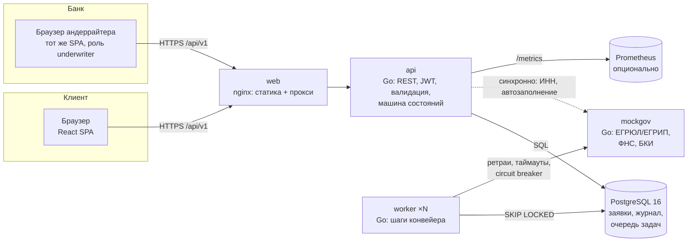
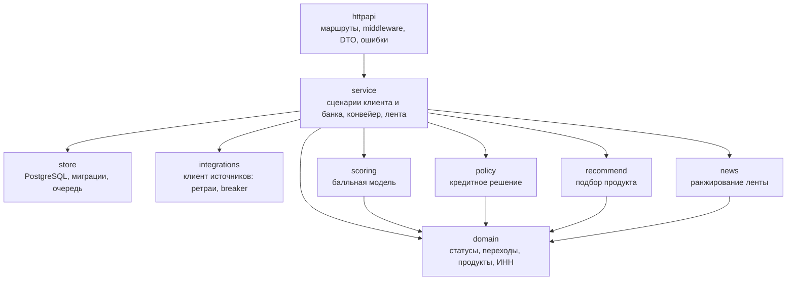
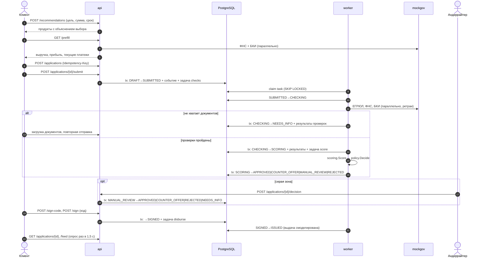

# Архитектура

## Компоненты

| Сервис | Ответственность | Масштабирование |
|---|---|---|
| `web` | Раздача SPA, прокси `/api` на `api` | stateless, любое число реплик |
| `api` | REST API, аутентификация, права, валидация, переходы статусов по действиям людей | stateless, любое число реплик за балансировщиком |
| `worker` | Автоматические шаги: проверки, скоринг, решение, выдача | горизонтально: `deploy.replicas`, задачи распределяются через `FOR UPDATE SKIP LOCKED` |
| `postgres` | Данные, журнал событий, очередь задач, ключи идемпотентности | вертикально / managed PostgreSQL |
| `mockgov` | Симулятор внешних источников с управляемыми сбоями | stateless |

`api` и `worker` — один бинарник `conveyor` с разными подкомандами (`api`, `worker`, `all`, `migrate`, `seed`).
Это упрощает сборку и гарантирует, что API и воркер используют одни и те же доменные правила.

## Слои бэкенда

- `domain`, `scoring`, `policy`, `recommend`, `news` — чистые функции без ввода-вывода. Их легко
  тестировать и менять независимо: например, заменить балльную модель на ML-модель, не трогая конвейер.
- `service` — единственное место, где меняется статус заявки (`transition`).
- `store` не содержит бизнес-логики: только запросы и транзакции.
- `integrations.Source` — интерфейс. Реальные ЕГРЮЛ/ФНС/БКИ подключаются новым адаптером без изменения конвейера.

## Сквозной поток заявки

## Надёжность и отказоустойчивость

| Риск | Что сделано |
|---|---|
| Процесс упал между сменой статуса и постановкой следующего шага | Transactional outbox: задача пишется в `tasks` в той же транзакции, что и переход |
| Воркер упал посреди шага | Задача «арендуется» на `TaskLease` (1 мин): `run_at` сдвигается вперёд, после истечения её возьмёт другой воркер |
| Внешний источник недоступен | Таймаут 3 с, 3 попытки с экспоненциальной задержкой, отдельный circuit breaker на каждый источник; заявка ждёт в `CHECKING`, задача повторяется с задержкой до 64 с, максимум 8 попыток |
| Двойное нажатие «Отправить» или повтор запроса после обрыва сети | `Idempotency-Key` на POST: повтор возвращает сохранённый ответ |
| Две вкладки редактируют одну заявку | Оптимистическая блокировка по `version` (`If-Match`), ответ `409 version_conflict` |
| Гонка двух воркеров на одной заявке | `SELECT … FOR UPDATE` в `transition` и проверка ожидаемого статуса |
| Несколько экземпляров стартуют одновременно | Миграции под `pg_advisory_lock` |
| Остановка контейнера | Graceful shutdown: API дожидается активных запросов, воркер завершает текущую задачу |

Задержка видна обеим сторонам: клиент получает объяснение без технических деталей («Сервис бюро кредитных историй
временно не отвечает, повторим автоматически»), андеррайтер — номер попытки и текст ошибки.

Демонстрация: в рабочем месте банка кнопки «30% запросов с ошибкой» и «Источники недоступны» включают
сбои в `mockgov`. Заявка остаётся в «Проверяем данные», в блоке «Очередь конвейера» растёт счётчик
повторов, а после «Без сбоев» конвейер сам доводит заявку до решения.

## Безопасность

- JWT HS256 с проверкой алгоритма (`alg=none` и чужой ключ отклоняются, есть тесты), срок жизни 12 ч.
- Пароли: PBKDF2-SHA256, 210 000 итераций, соль; сравнение за постоянное время. При неизвестном
  email ответ по времени не отличается от ответа на неверный пароль.
- Ограничение частоты входа и регистрации: 20 попыток в минуту с одного IP.
- Ролевой доступ: клиент видит только заявки своей компании, а чужая заявка отвечает `404`
  (не раскрываем существование). Решения принимает только андеррайтер.
- Загрузка файлов: до 10 МБ, тип определяется по содержимому (PDF/PNG/JPEG), имя файла очищается,
  хранится SHA-256.
- Клиенту не отдаются сырые ответы БКИ/ФНС, только итог проверки.
- JSON с неизвестными полями отклоняется, размер тела ограничен.
- Заголовки безопасности: `nosniff`, `X-Frame-Options: DENY`, `no-referrer`, `no-store`; CORS только для заданных origin.
- Контейнеры distroless, запуск не от root.
- SQL только с параметрами, без конкатенации пользовательского ввода.

## Наблюдаемость

- Структурные JSON-логи (`log/slog`) с `request_id`; идентификатор приходит из заголовка
  `X-Request-ID` или генерируется, возвращается в ответе и в теле ошибок, прокидывается во вызовы внешних источников.
- `/metrics` в формате Prometheus: `http_requests_total{route,code}`, `conveyor_tasks_total{kind,result}`,
  `conveyor_decisions_total{outcome}`, `conveyor_source_errors_total`, `conveyor_queue_tasks{state}`.
- `/healthz` (liveness) и `/readyz` (проверка БД), `HEALTHCHECK` в образах.
- Дашборд банка: заявки по статусам, доля автоматических решений, среднее время решения, состояние очереди.

## Зависимости

Бэкенд намеренно минималистичен — две внешние Go-зависимости:
`github.com/lib/pq` (драйвер PostgreSQL) и `github.com/golang-jwt/jwt/v5`. Роутинг — стандартный
`net/http` (Go 1.22+), хэширование паролей — `crypto/pbkdf2` из стандартной библиотеки. Меньше зависимостей —
меньше поверхность атаки и проще прохождение проверки библиотек в банке.
