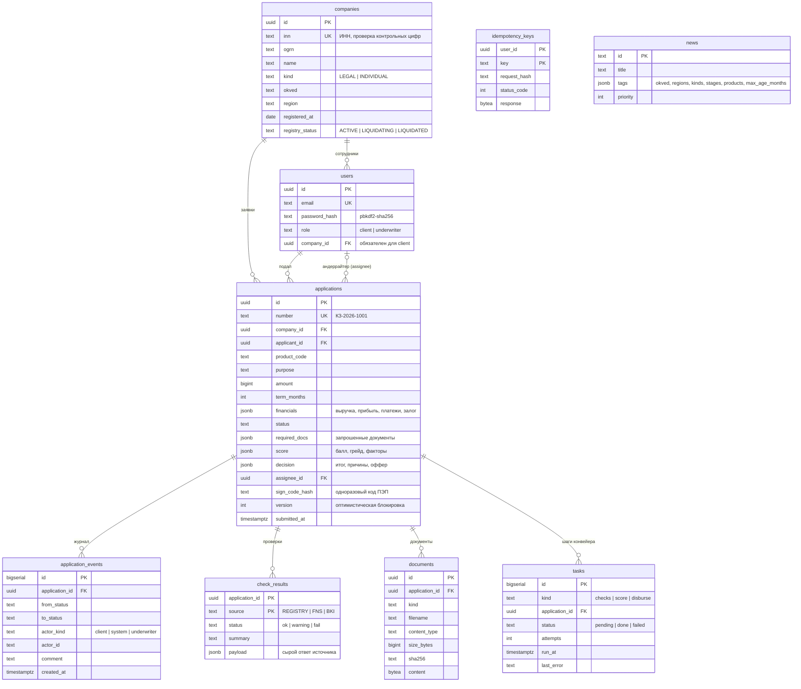

# Модель данных

Схема — `backend/internal/store/migrations/0001_init.sql`. Миграции встроены в бинарник и применяются
при старте (`AUTO_MIGRATE=true`) или командой `conveyor migrate`.

## Почему так

- **Заявка — агрегат, журнал — append-only.** Текущее состояние лежит в `applications`, история
  переходов — в `application_events`, где записи только добавляются. Из журнала строятся история для клиента,
  аудит и метрики времени решения.
- **JSONB для скоринга и решения.** Набор факторов модели и структура решения будут меняться с версиями
  политики. JSONB позволяет хранить их вместе с `model_version` и `policy_version` без миграции на каждое изменение.
  Поля, по которым нужен поиск и фильтр (статус, сумма, продукт), — обычные колонки с индексами.
- **Результаты проверок хранятся.** Скоринг строится по сохранённым ответам источников, а не по новым запросам.
  Решение воспроизводимо, а андеррайтер видит ровно те данные, на которых система приняла решение.
- **Очередь в той же БД.** Для MVP это даёт атомарность «переход + следующий шаг» без распределённых
  транзакций. При росте нагрузки таблица `tasks` превращается в outbox, который публикуется в Kafka,
  а воркеры становятся консьюмерами (см. `docs/decisions.md`).
- **Документы в `bytea`.** Для прототипа так проще. В проде файлы уходят в объектное хранилище (S3-совместимое),
  в БД остаются метаданные и хэш.
- **Справочник продуктов в коде** (`domain/product.go`). Параметры продуктов — часть кредитной политики и
  проходят ревью вместе с кодом. В проде это версионируемый справочник.
