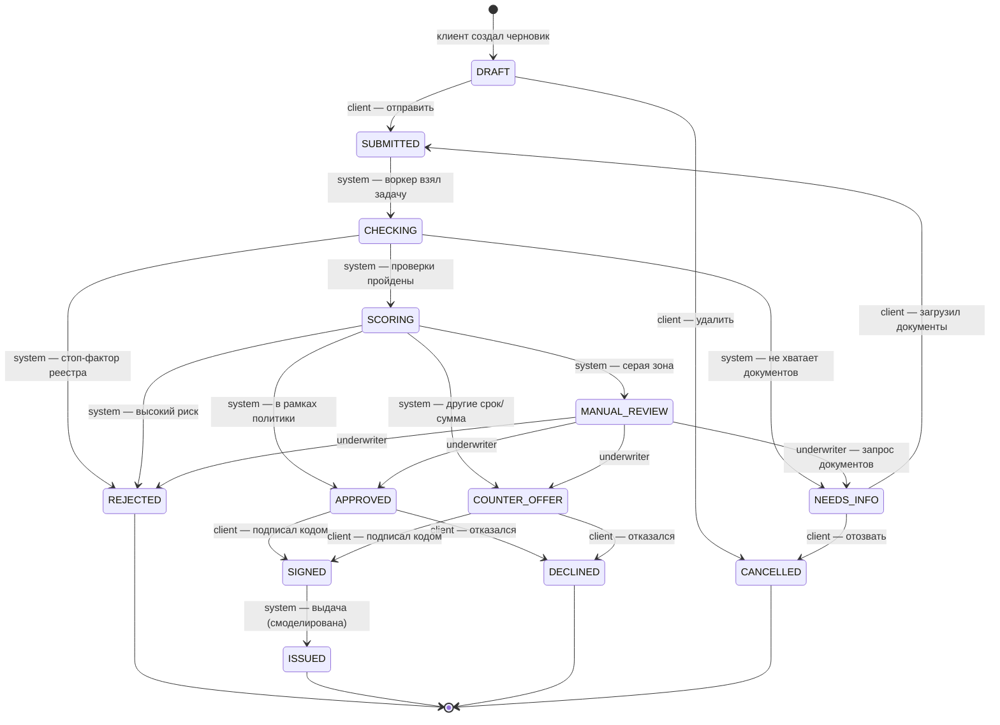

# Диаграмма состояний заявки

Единственный источник правды — `backend/internal/domain/status.go` (таблица `transitions`).
Тест `TestStateMachineDocIsInSync` проверяет, что каждый переход из кода есть на этой диаграмме,
поэтому документ не может разойтись с реализацией.

## Статусы

| Статус | Кто ждёт | Что видит клиент | Этап конвейера |
|---|---|---|---|
| `DRAFT` | клиент | Черновик — проверьте и отправьте | Заявка |
| `SUBMITTED` | банк | Отправлена, стоит в очереди | Проверки |
| `CHECKING` | банк | Сверяем данные с ЕГРЮЛ/ЕГРИП, ФНС, БКИ | Проверки |
| `NEEDS_INFO` | клиент | Нужны документы — список с причинами | Проверки |
| `SCORING` | банк | Оцениваем заявку | Оценка |
| `MANUAL_REVIEW` | эксперт | На рассмотрении у специалиста | Оценка |
| `APPROVED` | клиент | Одобрено — подпишите договор | Решение |
| `COUNTER_OFFER` | клиент | Предложение на других условиях — сравните | Решение |
| `REJECTED` | — | Отказ с причинами и рекомендациями | Решение |
| `SIGNED` | банк | Договор подписан, готовим выдачу | Деньги |
| `ISSUED` | — | Кредит выдан, график платежей | Деньги |
| `DECLINED` | — | Клиент отказался от предложения | Решение |
| `CANCELLED` | — | Заявка отозвана | Заявка |

## Гарантии

- **Только разрешённые переходы.** Любое изменение статуса проходит через `service.transition`:
  блокировка строки `SELECT … FOR UPDATE` → `domain.ValidateTransition(from, to, actor)` → сохранение
  с проверкой версии → запись события в `application_events` → постановка следующей задачи в `tasks`.
  Всё в одной транзакции.
- **Проверка актора.** Одобрить может только система или андеррайтер, подписать — только клиент.
  Попытка клиента принять решение возвращает `403`, недопустимый переход — `409 invalid_transition`.
- **Идемпотентность шагов.** Воркер обрабатывает задачи «как минимум один раз». Каждый шаг сначала
  проверяет, что заявка всё ещё в ожидаемом статусе, поэтому повтор задачи ничего не ломает.
- **Полный журнал.** Каждый переход записан с автором, временем и комментарием — клиент видит его
  как историю заявки, банк — как аудит.
